# 念念 使用说明

> 一个 AI 聊天软件，可以让你的前任永远留在你的手机。

这篇是**从装到用**的完整步骤。所有配图都是在真机（Android 15 / API 37 模拟器）上截的，
不是画的示意图 —— 你看到的界面，就是装上之后看到的界面。

**目录**

1. [装之前先看这两件事](#一装之前先看这两件事)
2. [装上、第一次打开](#二装上第一次打开)
3. [★ 接一个模型（最关键的一步）](#三-接一个模型最关键的一步)
4. [挑一个人设 / 导入角色卡](#四挑一个人设--导入角色卡)
5. [开始聊天](#五开始聊天)
6. [设置里能改什么](#六设置里能改什么)
7. [检查更新（以及为什么它经常失败）](#七检查更新以及为什么它经常失败)
8. [你的数据在哪、怎么备份](#八你的数据在哪怎么备份)
9. [授权条款在哪看](#九授权条款在哪看)
10. [常见问题](#十常见问题)
11. [附录：附带的 10 个角色卡](#附录附带的-10-个角色卡)

---

## 一、装之前先看这两件事

### 1. 只支持 64 位安卓手机

| 你的手机 | 能不能装 |
|---|---|
| 2018 年之后买的安卓手机（arm64-v8a） | ✅ 能 |
| 很老的 32 位手机 | ❌ 装不了 |
| 安卓模拟器（x86_64） | ❌ 装不了 |

系统要求：**Android 7.0（API 24）及以上**。

### 2. 它不自带 AI 接口，你得自己准备

这一点最重要，先说明白：**App 里没有任何内置的 AI，也不代你付费。**
你需要自己有一份「模型服务的接口地址 + API Key」，填进去才能聊天。

绝大多数支持 **OpenAI 兼容接口**的服务都能用（格式是 `https://.../v1` 这种）。
如果你手上还没有，先去找一家，再往下看。

---

## 二、装上、第一次打开

从 [Releases](../../releases) 下载 `niannian-<版本>-arm64-v8a.apk`，传到手机点开安装。
提示「未知来源」就允许；如果提示**签名不一致**，说明手机上原来那个不是用同一把钥匙签的，
必须卸载重装（数据会没，先备份）。

★ 包名是 `com.aiai.pub`。很早以前公开过的包名是 `com.aiai.app`，两个**在系统里是两个不同的 App**
⇒ 以前装过老包的话，新包会装成**第二个图标**，两个能同时存在；确认新的能用之后把老的卸载即可
（聊天记录不通用，先用老的「一键备份」再在新的里导入）。

第一次打开是四步引导，每步都可以直接点「跳过引导」：

| 第 1 步 | 第 2 步 |
|---|---|
| 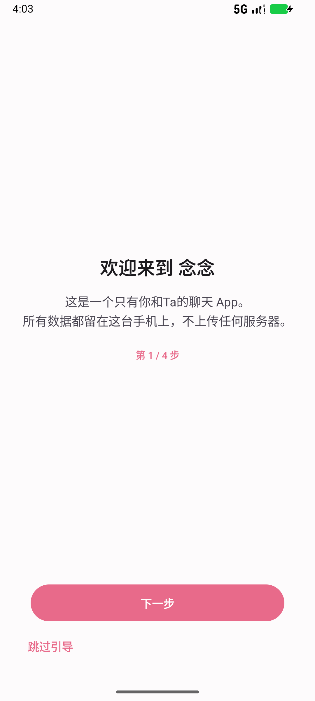 | 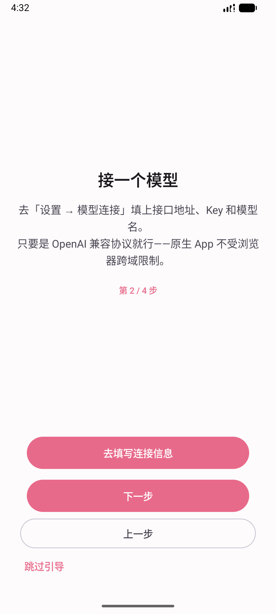 |
| 告诉你数据都留在本机 | 告诉你下一步该去填模型 |

| 第 3 步 | 第 4 步 |
|---|---|
| 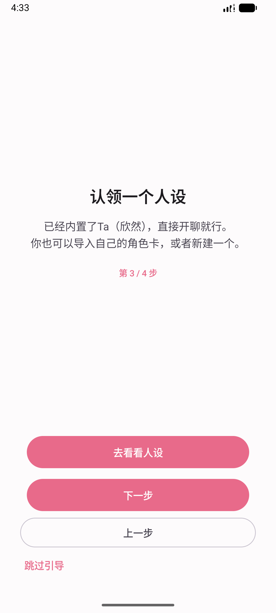 | 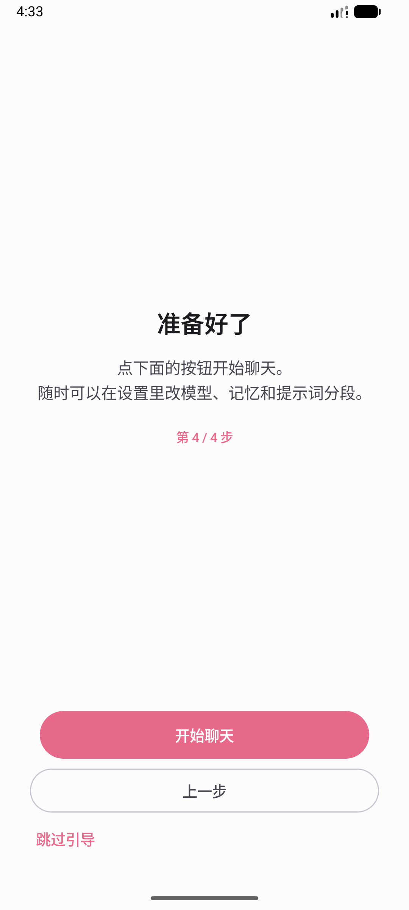 |
| 告诉你内置了一个角色，也可以导入自己的 | 点「开始聊天」进入首页 |

> 第一次进首页还会弹一次「**更新说明**」（这个版本改了什么）：

> 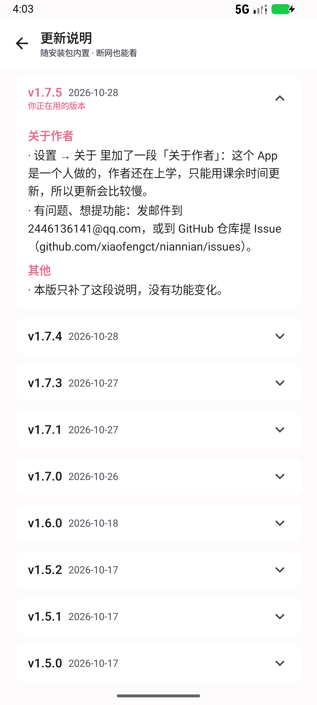

> 它**随安装包内置，断网也能看** —— 所以新版本改了什么，你在没有网的时候也能翻。

---

## 三、★ 接一个模型（最关键的一步）

**不填这一步，App 能打开但没法聊天。** 界面长这样：

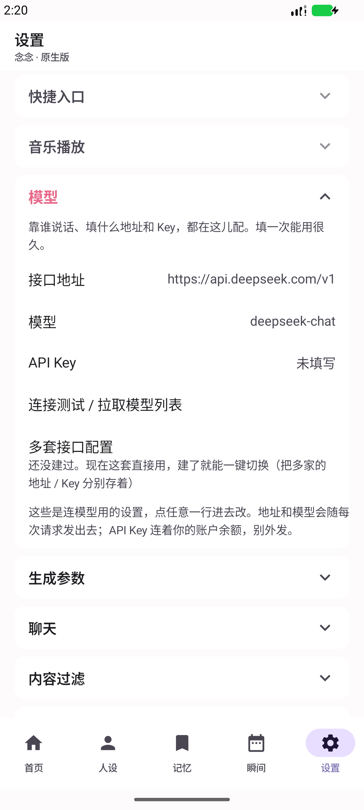

进法：**设置 → 模型**，然后点要改的那一行。

| 要填的 | 说明 | 例子 |
|---|---|---|
| **接口地址** | 服务商给你的 baseUrl，一般以 `/v1` 结尾 | `https://api.deepseek.com/v1` |
| **模型名** | 你想用哪个模型 | `deepseek-chat` |
| **API Key** | 服务商给你的那串密钥 | `sk-...` |

填完可以点 **「连接测试 / 拉取模型列表」** 验证一下 —— 通了就说明地址和 Key 都对。

几点要注意：

- **这三样只存在你自己的手机上**，不上传任何服务器。
- 接口地址和模型名**会随「一键备份」一起导出**（方便换机）；**API Key 不在备份里**，它单独存放。
- 要是有多家，可以用 **「多套接口配置」** 各存一套，之后一键切换。
- 地址填 **`http://`** 开头的（比如你自己的局域网模型服务）也能用 —— 这个 App 是原生应用，
  不受浏览器跨域限制，也没有强制 HTTPS。

> 如果你卡在这一步：先确认 `接口地址` 末尾的 `/v1` 有没有漏、Key 有没有多复制空格。
> 这两条占了新手失败的绝大多数。

---

## 四、挑一个人设 / 导入角色卡

### 4.1 默认已经有一个

App 内置了一个角色（**欣然**），装完就能直接聊，不用配任何东西。

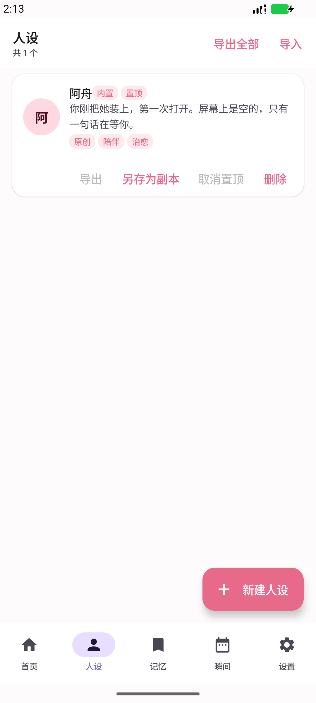

进法：底部导航 **「人设」**。右上角三个入口：`导出全部` / `导入` / 底部浮动按钮 `新建人设`。

### 4.2 导入角色卡（本仓库附了 10 个）

角色卡是标准的 **`chara_card_v2`** JSON 文件 —— 也就是 SillyTavern / Character Card V2 那套格式，
所以你在别处拿到的卡，基本都能直接导入。

**第一步**：把 JSON 文件传到手机，放哪个目录都行（下面演示放在「下载」里）。

**第二步**：人设页右上角点 **「导入」**，会弹出系统的文件选择器：

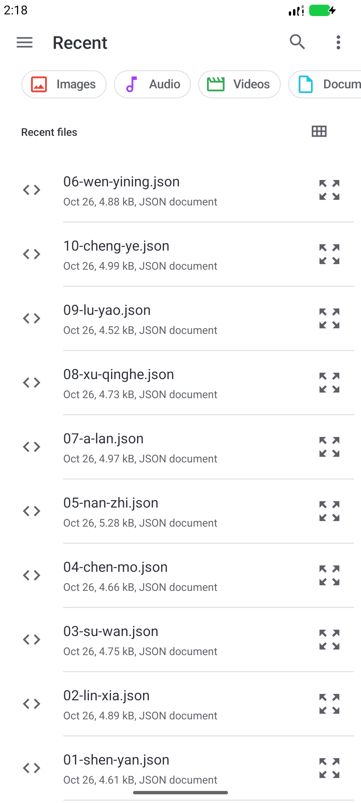

**第三步**：点那个 `.json` 文件。**没有任何确认框**，选完就直接导入成功了：

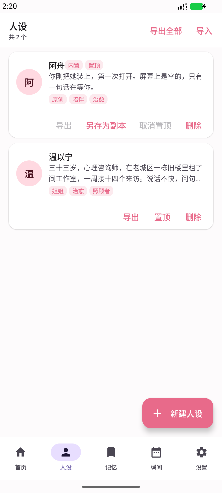

图上原本只有 1 个角色，导入后变成 2 个 —— 新卡片「温以宁」出现了，标签（姐姐 / 治愈 / 照顾者）
和简介都正确显示。这就是导入成功的标志。

**第四步（可选）**：导入的卡可以 `导出` / `置顶` / `删除`。
内置的「欣然」只能 `另存为副本`，不能删除也不能改原文。

> ### 怎么用仓库里那 10 个角色卡？
>
> 本仓库的 [`personas/`](personas/) 目录下有 **40 张**卡：`personas/xiaofeng/` 里是 **30 张原创卡**（作者 xiaofeng，可自由分发、可自己改），根目录还有另 10 张。
> 在电脑上打开某个文件 → 点右上角 **Raw** → 另存为 `.json`；
> 或者 `git clone` 下来，把 `personas/` 里的文件传到手机。
> 然后照上面三步导入就行。**每个文件就是一个角色**，想用哪个导哪个。

---

## 五、开始聊天

回到 **「首页」**：

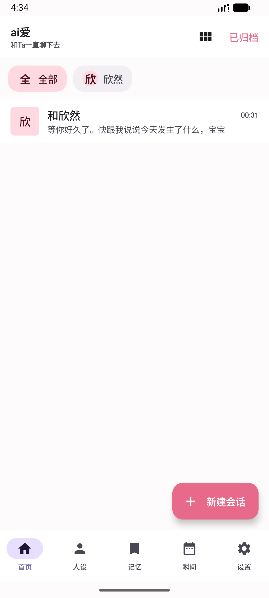

- 点右下角 **「＋ 新建会话」** 开一个新的对话
- 点已有的会话卡片继续聊
- 顶部的 `全 / 全部 / 欣 / 欣然` 是**筛选器**，角色多了以后用来过滤
- 顶部右上角 **「已归档」** 里是被你归档的会话

> 会话卡片上那行小字是**最后一条消息**的预览。

---

## 六、设置里能改什么

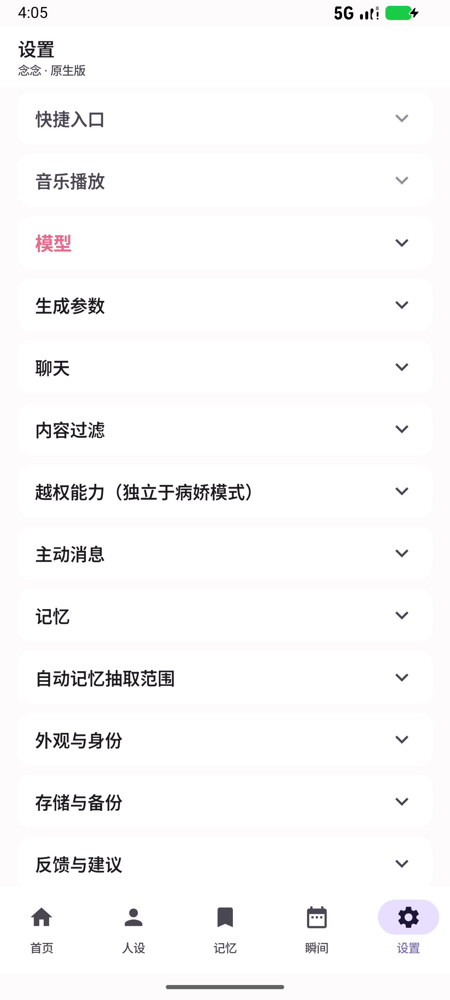

从上到下大致是：

| 分组 | 里面有什么 |
|---|---|
| **快捷入口** | 音乐播放 |
| **模型** | 接口地址、模型名、API Key、连接测试、多套配置 |
| **生成参数** | 温度、top_p 这类「她说话有多放飞」的旋钮 |
| **聊天** | 气泡、字号、自动播放语音条等 |
| **内容过滤** | 过滤规则的开关 |
| **越权能力** | ★ 独立于病娇模式，默认关，需要单独授权 |
| **主动消息** | 她会不会主动来找你、什么时候找 |
| **记忆** / **自动记忆抽取范围** | 记什么、记多久、检索范围多大 |
| **外观与身份** | 主题、「窗口最小化」等 |
| **存储与备份** | 一键备份 / 还原 |
| **反馈与建议** | 有问题从这里提 |
| **高级** | 诊断、能力总览这类 |
| **关于** | 版本、检查更新、更新说明、鸣谢、邀请、**用户协议 / 隐私说明 / 病娇互动协议** |

★ 这一版新增的开关**绝大多数默认关闭**，不动它们，用起来跟你以前一样。

---

## 七、检查更新（以及为什么它经常失败）

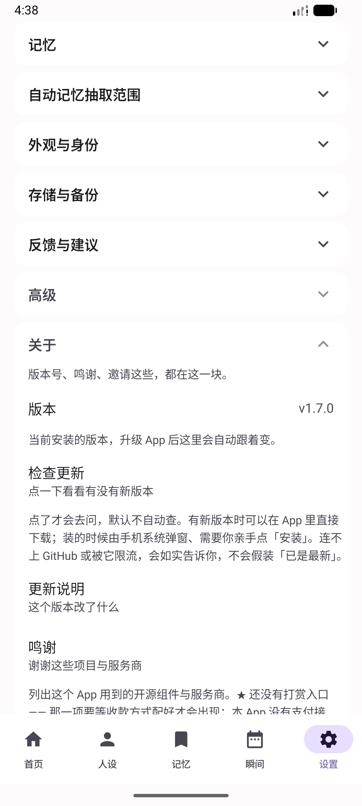

入口：**设置 → 关于 → 检查更新**。

它的承诺写得很清楚，也是实际行为：

> 点了才会去问，默认不自动查。有新版本时可以在 App 里直接下载；装的时候由手机系统弹窗、
> 需要你亲手点「安装」。连不上 GitHub 或被它限流，**会如实告诉你，不会假装「已是最新」**。

下载完它会先**在本机核对三样**：包的大小、指纹、以及这个包是不是「念念」本身（包名）。
三样里任何一样对不上，都会把文件丢掉、不交给系统安装 —— 所以哪怕更新源被人换掉了，
也不会把别的应用装进你手机。

### ⚠️ 在国内，它大概率会给你这个

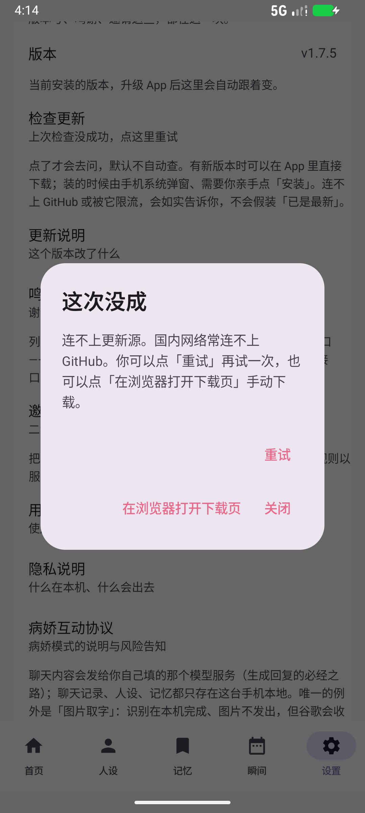

> 这次没成 / 连不上更新源。国内网络常连不上 GitHub。

**这不是 bug，是网络。** 更新源放在 `raw.githubusercontent.com`，这个域名在国内经常解析不了。

你可以：

- 点 **「重试」** 再试一次（网络换了环境有时会通）
- 点 **「在浏览器打开下载页」** 手动下载 —— 最省事，直接跳 Releases
- 挂代理之后再用「检查更新」
- 什么都不做，**App 其它功能完全不受影响**（只有这一个按钮会碰这个域名）

★ 判断标准只有一条：**只要它没有在连不上的时候显示「已是最新版本」，就是对的。**

---

## 八、你的数据在哪、怎么备份

- 聊天记录、人设、设置、附件**全部存在这台手机上**，这个仓库收不到任何东西。
- **唯一会出网的地方**：连你自己配的那个模型服务（不然生成不了回复）。
  「检查更新」只向 GitHub 要一个 JSON 文件，不带你的任何内容。
- **卸载 App 会连同本机数据一起删掉。**

备份：**设置 → 存储与备份 → 一键备份**，导出一份 JSON。
里面包含会话、消息、人设、设置；**API Key 不在里面**（它单独存放）。

---

## 九、授权条款在哪看

**设置 → 关于 → 用户协议**（这份文本随安装包内置，断网也能看）：

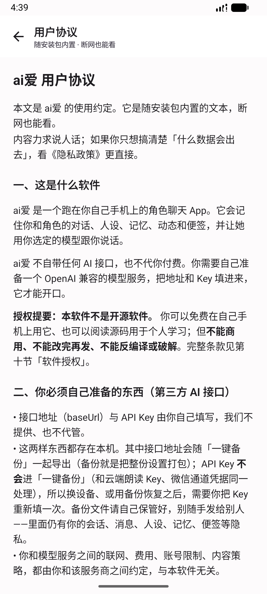

开头就有一段加粗提要：「**授权提要：本软件不是开源软件。**」

往下翻到**第十节**：

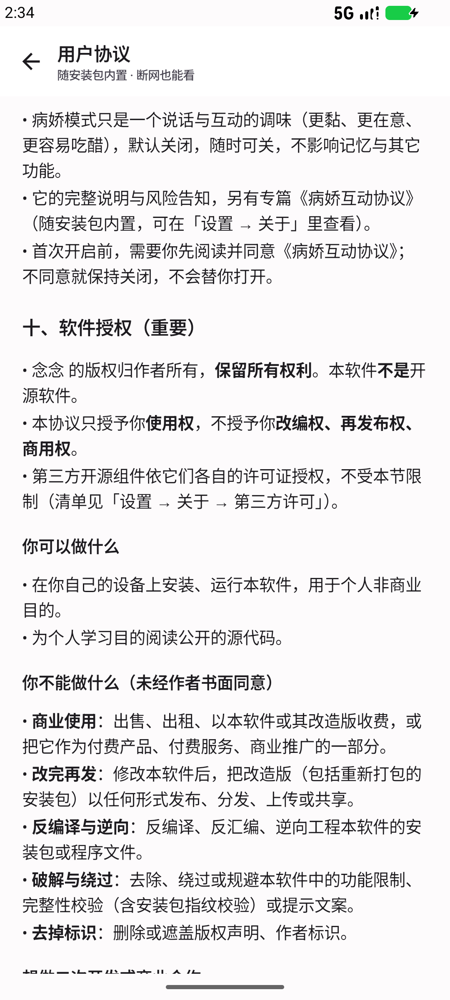

一句话总结：

| 你可以 | 你不可以（未经作者书面同意） |
|---|---|
| 装在自己手机上用 | 商业使用 |
| 为个人学习阅读源码（如果你拿到了） | 改完再分发 / 重打包 |
| | 反编译、逆向 |
| | 破解、绕过校验 |

**二次开发 / 商业合作必须先取得作者书面同意。** 完整条款见 [LICENSE](LICENSE)。

---

## 十、常见问题

### 装不上 / 提示「应用未安装」

两种常见原因：

1. **手机是 32 位或模拟器** → 本 App 只发 64 位真机包，装不了。
2. **签名不一致** → 手机上那个不是同一把钥匙签的。必须卸载重装（数据会没，先备份）。

### 能打开，但发消息一直失败

99% 是模型没配好。去 **设置 → 模型**：

- 接口地址是不是漏了 `/v1`
- API Key 有没有多复制空格或引号
- 点 **「连接测试 / 拉取模型列表」** 看具体报什么

### 「检查更新」总是失败

看[第七节](#七检查更新以及为什么它经常失败) —— 国内网络问题，不是 bug。手动去 Releases 下就行。

### 导入角色卡没反应

- 确认文件是 `.json`，不是 `.txt` 或 `.zip`
- 确认它至少有一个 `name` 字段（或者符合 `chara_card_v2` 格式）
- 导入**没有确认框**，选完就已经导入了 —— 回人设页看「共 N 个」有没有 +1

### 她说话很奇怪 / 不符合人设

- 模型本身的能力限制，换个强一点的模型试试
- 在 **设置 → 生成参数** 里把「温度」调低一点，输出会稳定些
- 人设写得越具体（职业、习惯、说话方式），效果越好 —— 本仓库附的 10 个卡就是按这个思路写的

---

## 附录：附带的 10 个角色卡

### 30 张原创卡（`personas/xiaofeng/`）

作者 **xiaofeng**，全部原创、**不包含任何已有作品里的角色**，**可自由分发、随意使用、也可以自己改**。覆盖恋爱 / 学园 / 仙侠 / 科幻 / 悬疑 / 武侠 / 职场 / 历史 / 奇幻 / 治愈 / 搞笑 / 拟人 / 市井，每张卡都附了一条**建议音色**。完整清单见 [`personas/xiaofeng/README.md`](personas/xiaofeng/README.md)。

### 另 10 张（`personas/` 根目录）

都在 [`personas/`](personas/) 目录，全部是 `chara_card_v2` 格式，导入即用。

| 文件 | 角色 | 类型 | 一句话 |
|---|---|---|---|
| `01-shen-yan.json` | 沈砚 | 男 · 前任 | 建筑师，分手三年后在地铁站遇到，什么都记得，什么都不肯先说 |
| `02-lin-xia.json` | 林夏 | 女 · 前任 | 绘本编辑，当年为了出国走的，现在回来了 |
| `03-su-wan.json` | 苏晚 | 女 · 前任 | 律师，分手是她提的，现在跟你同楼办公 |
| `04-chen-mo.json` | 陈默 | 女 · 青梅竹马 | 住你对门二十七年，下个月要搬走了 |
| `05-nan-zhi.json` | 南栀 | 女 · 病娇 | 插花师，黏人是怕被丢下，不是想控制你 |
| `06-wen-yining.json` | 温以宁 | 女 · 姐姐 | 心理咨询师，太会照顾人，反而没人照顾她 |
| `07-a-lan.json` | 阿岚 | 女 · 前任 | 乐队鼓手，热烈、直接、不肯给承诺 |
| `08-xu-qinghe.json` | 许清和 | 男 · 同桌 | 研究员，话少，十年没联系，一直在「等以后」 |
| `09-lu-yao.json` | 陆遥 | 女 · 旅伴 | 背包客，一起走过川西七天，然后各回各家 |
| `10-cheng-ye.json` | 程野 | 男 · 前任 | 消防员，你家厨房着火那天来的就是他 |

### 这些卡是怎么写的

每个角色都包含：`description`（身份 + 你和她的关系）、`personality`（性格与行为模式）、
`scenario`（开局情境）、`first_mes`（她说的第一句话）、`mes_example`（几轮对话示例，
用来定语气）、以及 `character_book`（2 条关键词触发的背景设定）。

写法上有意避开两件事：

- **不写空泛形容词**（「她很温柔」），写**具体行为**（「你随口说胃不舒服，第二天她带药过来」）。
- **不写「攻略」**，写**矛盾** —— 每个人都有一个不肯说出口的东西，那才是能聊下去的地方。

### 想自己写一个？

最省事的做法：复制一个现成的 `.json`，改 `name` / `description` / `first_mes` 三个字段，
导入试聊，觉得对了再慢慢补 `mes_example` 和 `character_book`。

`first_mes` 决定第一印象，值得多改几遍 —— 它是整段对话的起点。

---

本仓库仅用于分发更新信息、安装包与角色卡。问题反馈请用 App 内「设置 → 反馈与建议」。
